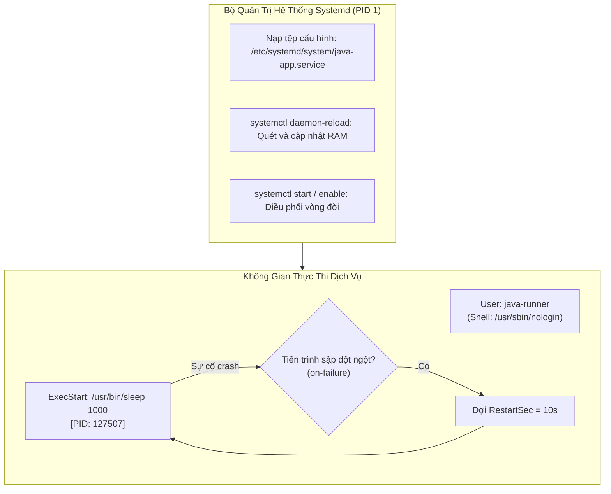

# Báo Cáo Bài Tập 5: Thiết Kế Và Cấu Hình Dịch Vụ Systemd Service Cho Ứng Dụng Java

- **Môn học**: DevOps Fundamentals (IT-209)
- **Session**: 06 - Linux Administration, Permissions & Process Management
- **Bài tập**: Bài 5 - Thiết kế và cấu hình dịch vụ Systemd Service cho ứng dụng Java
- **Đường dẫn nộp bài trên GitHub**: `homework/session_06/ex5/`
- **Học viên**: HoQuocKhai
- **Email**: khaiho6040@gmail.com

---

## 1. Mục tiêu bài thực hành
1. **Thiết kế tệp cấu hình Systemd Service Unit**: Nắm vững cấu trúc 3 khối cốt lõi `[Unit]`, `[Service]`, `[Install]` để hệ điều hành quản lý vòng đời ứng dụng tự động.
2. **Nâng cao bảo mật với System User giới hạn**: Vận hành ứng dụng dưới quyền một người dùng không có quyền đăng nhập shell (`/usr/sbin/nologin`), tuân thủ nguyên tắc đặc quyền tối thiểu (Least Privilege).
3. **Cài đặt chính sách tự phục hồi (Self-healing Policy)**: Tự động khởi động lại dịch vụ sau 10 giây khi tiến trình bị sập bất thường (`Restart=on-failure`, `RestartSec=10s`).
4. **Sử dụng bộ công cụ `systemctl`**: Thành thạo các thao tác `daemon-reload`, `start`, `enable` và theo dõi trạng thái bằng `status`.

---

## 2. Cơ sở lý thuyết: Cấu trúc Systemd Service Unit



- **`[Unit]`**: Định nghĩa siêu dữ liệu (`Description`) và điều kiện phụ thuộc mạng (`After=network.target` - chỉ khởi động sau khi hệ thống mạng đã sẵn sàng).
- **`[Service]`**:
  - `Type=simple`: Loại dịch vụ cơ bản nhất, tiến trình chạy chính là lệnh chỉ định trong `ExecStart`.
  - `User=java-runner`: Cách ly quyền hạn, ngăn ứng dụng chạy dưới quyền `root`.
  - `ExecStart=/usr/bin/sleep 1000`: Lệnh khởi chạy ứng dụng (giả lập tiến trình ứng dụng Java).
  - `Restart=on-failure`: Tự động khởi động lại khi tiến trình kết thúc với mã lỗi khác 0 hoặc bị tín hiệu hệ thống hủy bỏ bất ngờ.
  - `RestartSec=10s`: Khoảng thời gian giãn cách 10 giây trước khi Systemd thử khởi động lại.
- **`[Install]`**:
  - `WantedBy=multi-user.target`: Cho phép dịch vụ tự khởi động cùng hệ thống khi máy chủ boot vào chế độ đa người dùng (Runlevel 3 / multi-user).

---

## 3. Nội dung tệp tin cấu hình dịch vụ [java-app.service](file:///d:/%5BIT-209%5D%20DevOps%20Fundamentals/Ss06/5/java-app.service)

Tệp cấu hình được đặt tại `/etc/systemd/system/java-app.service`:
```ini
[Unit]
Description=My Java Service
After=network.target

[Service]
Type=simple
User=java-runner
ExecStart=/usr/bin/sleep 1000
Restart=on-failure
RestartSec=10s

[Install]
WantedBy=multi-user.target
```

---

## 4. Quá trình thực hiện chi tiết

### Bước 1: Tạo tài khoản người dùng hệ thống an toàn
Tạo tài khoản hệ thống `java-runner` không có quyền mở shell:
```bash
sudo useradd -r -s /usr/sbin/nologin java-runner
```
*Giải thích:*
- `-r`: Chỉ định tạo tài khoản hệ thống (System User) không có thư mục home thông thường.
- `-s /usr/sbin/nologin`: Ngăn chặn bất kỳ ai đăng nhập trực tiếp vào hệ thống bằng tài khoản này.

---

### Bước 2: Tạo tệp cấu hình và nạp lại daemon Systemd
Soạn thảo tệp cấu hình:
```bash
sudo nano /etc/systemd/system/java-app.service
```

Sau khi lưu tệp, yêu cầu Systemd nạp lại toàn bộ cấu hình dịch vụ mới từ đĩa cứng:
```bash
sudo systemctl daemon-reload
```

---

### Bước 3: Khởi chạy dịch vụ và kích hoạt tự khởi động cùng hệ thống
Khởi chạy dịch vụ:
```bash
sudo systemctl start java-app.service
```

*(Khuyến nghị cho môi trường Production)* Kích hoạt tự bật khi boot máy:
```bash
sudo systemctl enable java-app.service
```

---

## 5. Kết quả kiểm tra trạng thái dịch vụ (`systemctl status`)

Kiểm tra trạng thái hoạt động thực tế trên máy chủ:
```bash
devops@1161186107523368:~$ sudo systemctl status java-app.service
```

**Log đầu ra chi tiết từ hệ thống:**
```text
● java-app.service - My Java Service
     Loaded: loaded (/etc/systemd/system/java-app.service; disabled; preset: enabled)
     Active: active (running) since Wed 2026-10-07 13:30:21 BST; 11s ago
   Main PID: 127507 (sleep)
      Tasks: 1 (limit: 4556)
     Memory: 192.0K (peak: 732.0K)
        CPU: 8ms
     CGroup: /system.slice/java-app.service
             └─127507 /usr/bin/sleep 1000

Oct 07 13:30:21 1161186107523368 systemd[1]: Started java-app.service - My Java Service.
```

**Phân tích kết quả:**
- **`Active: active (running)`**: Dịch vụ đã được khởi động và đang hoạt động ổn định.
- **`Main PID: 127507`**: Tiến trình được quản lý độc lập bởi Systemd dưới Control Group `/system.slice/java-app.service`.
- **Tài nguyên**: Tiêu thụ 192.0K bộ nhớ RAM và 8ms CPU.
- **Log nhật ký**: Systemd ghi nhận sự kiện `Started java-app.service - My Java Service` thành công.

---

## 6. Kết luận
- Đã đóng gói thành công ứng dụng giả lập thành dịch vụ nền chuẩn Systemd.
- Đảm bảo an toàn thông tin nhờ cơ chế chạy dưới user `java-runner` có shell `/usr/sbin/nologin`.
- Thiết lập sẵn sàng cơ chế tự hồi sinh (Self-healing) với chính sách `Restart=on-failure` và `RestartSec=10s`.
